<p align="center">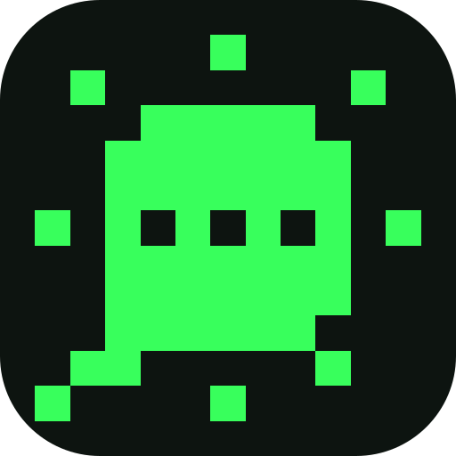</p>

# Chatterday

> **This project is shared as-is.** It was built for one group of friends and is published so others can run their own. I'm not maintaining this repo: issues and pull requests probably won't get answers. **Fork it and make it yours.** See [Disclaimer](#disclaimer-and-credits).

A private hangout for you and a few friends, hosted on your own PC.

Voice chat, text chat, screen sharing, a shared soundboard, music from YouTube, and a pixel-art house where everyone's character shows what they are up to. Down the stairs there's a game room, a karaoke lounge and a D&D table. Out the back door there's a campsite, a backyard pool, a lake to fish in and nine holes of mini golf.

No accounts with anyone else. No monthly bill. Your chat never leaves your computer.

> **Content note:** the house depicts alcohol and tobacco use (a bar with drinks, beer pong, a smoking table). It's meant for a group of adult friends.

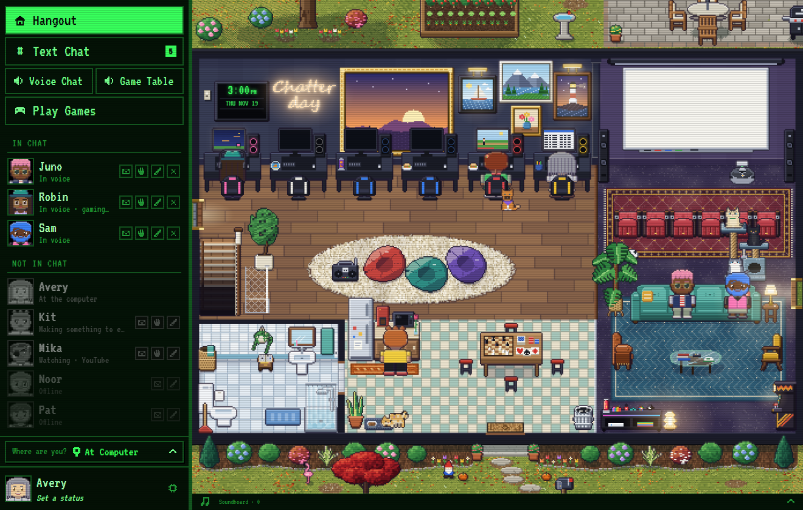

## What it is

You run a small server on a Windows PC.

Your friends install a desktop app that connects to it over a private network (Tailscale, which is free).

Everyone gets a character they build themselves. The house moves them around on its own: at a desk when they are at the computer, on the sofa when they are in voice, in the theatre seats when somebody shares a screen, out the door when they are away.

It is built for a small group. The house has six desks, and each desk turns into a bed when its owner goes to sleep. More than six people can have accounts, and anyone past the sixth who is online at once is a visitor with a laptop.

## What you get

**Talking**

- One voice chat and a side room for a couple of people off doing something else.
- Screen sharing. Share a window and the others hear that program and nothing else. A share nobody is watching drops to 2 frames a second until somebody looks.
- With an LGPL build of ffmpeg packed into the installer (optional, see [docs/FFMPEG.md](docs/FFMPEG.md)), the desktop app captures with the graphics card's own encoder, which is much lighter on a PC that's also running a game.
- A mic test, a noise gate, push to talk, and per-person volume.
- Louder voices are turned down to match the quietest one, so nobody booms.

**Chat**

- One text chat for the group, plus private chats between two people.
- Threads: reply to a message in a thread of its own, so a side conversation doesn't bury the main one.
- GIF search, link previews, spoilers, reactions, search, file and picture uploads.
- Chat is kept for good in a database on the host PC.

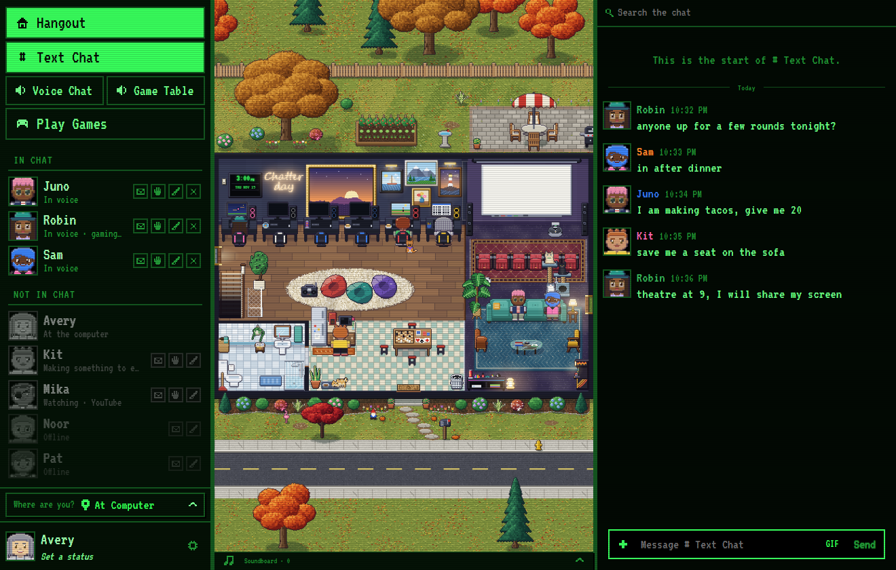

**Together**

- A soundboard that belongs to the group. Add a sound and everyone gets the button.
- A shared Player. Type a song or paste a YouTube link and it plays for everyone in voice at the same moment.
- A whiteboard on the wall that anyone can draw on, and Draw & Guess on it: one person draws a word only they can see, and everyone else guesses.
- Entrance and exit sounds, a doorbell when somebody signs on, a wave to call somebody over.

**Games**

- A game table for up to four: Hearts, Spades, Rummy, Mahjong (with a coach that says how far your hand is from ready), Chess, Checkers, Go, Four in a Row and Mancala. Empty seats can be filled by the house.
- An arcade machine with four games of its own and a high-score board.
- A football to kick round the room, and paper to throw at the kitchen bin. The house keeps count.
- A sudoku book on the coffee table.
- Downstairs and outside, more (see below): pool, darts, Texas Hold'em, shuffleboard, bowling, beer pong, cornhole, horseshoes, bocce, fishing and mini golf.
- **Play Games** lists all 21 games. Pick one and your character walks there, down the stairs or out the door if it has to.
- Trophies for all of it, on a rack in the basement, with a progress bar for the ones you haven't earned yet.

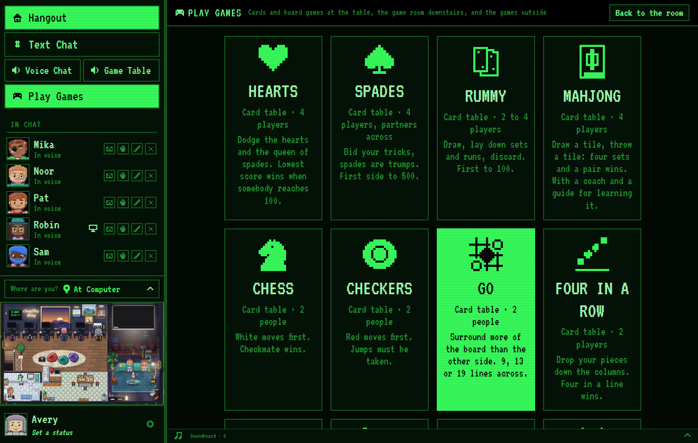

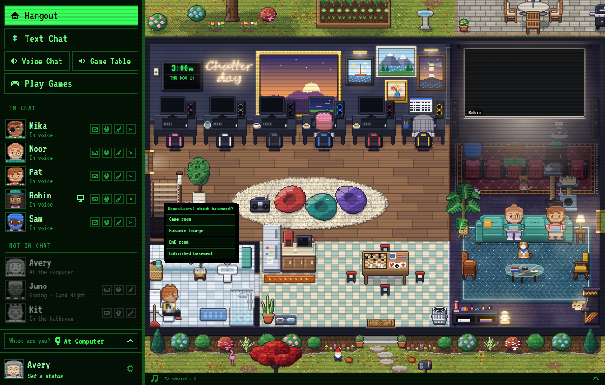

## Downstairs and outside

The house has more than one floor. Take the stairs down, or walk out of a side door, and everyone sees you go. Your friends in the list can see where you've got to ("in voice · at the lake"), and voice chat carries on wherever you are.

**The game room.** A bar with stools, a jukebox, a pool table, darts, a poker table for Texas Hold'em, shuffleboard and a bowling lane. The TVs over the bar show what's on the projector upstairs.

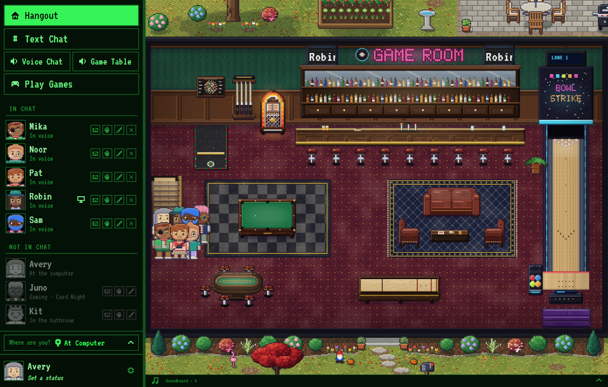

**The karaoke lounge.** A stage, a big screen and a sign-up list. Sign up with a song (searched on YouTube with the host's key, karaoke versions first) and the lounge works through the line-up in the shared Player, with an announcer calling up whoever's next.

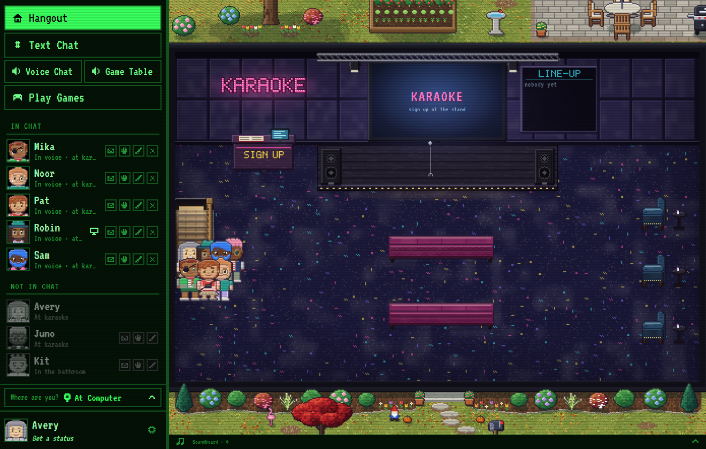

**The D&D room.** A war table at the side of the room: upload a map and set its grid, place tokens, measure, ping, and draw. There are dice (with advantage, disadvantage and secret rolls), an initiative order and character sheets. Anybody can run it, or somebody can take the DM's chair.

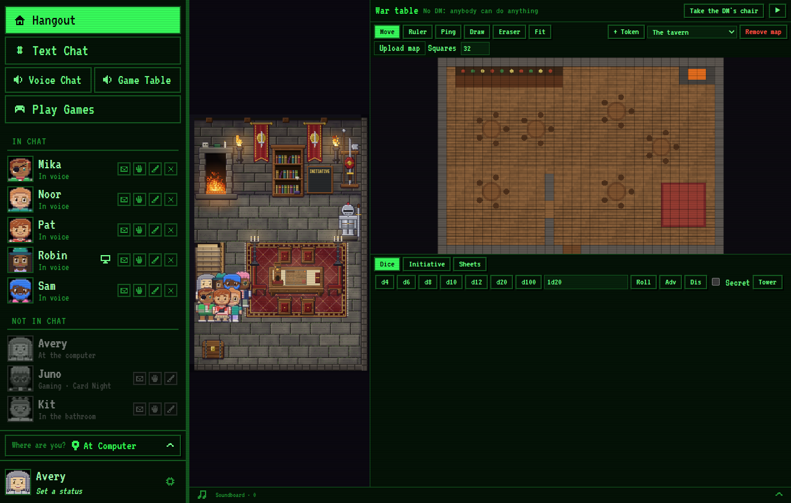

**The unfinished basement.** A bare bulb, an old couch, the laundry and the trophy rack.

**The campsite**, out the east door: a fire, chairs, a tent and cornhole. At night it's lit by the fire and the lanterns.

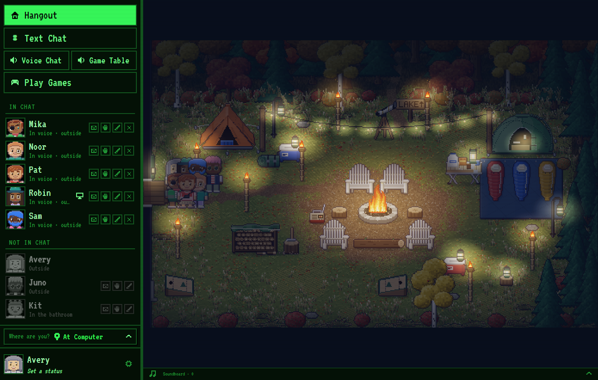

**The backyard**, out the west door: a pool, a hot tub, a patio, beer pong, horseshoes and bocce.

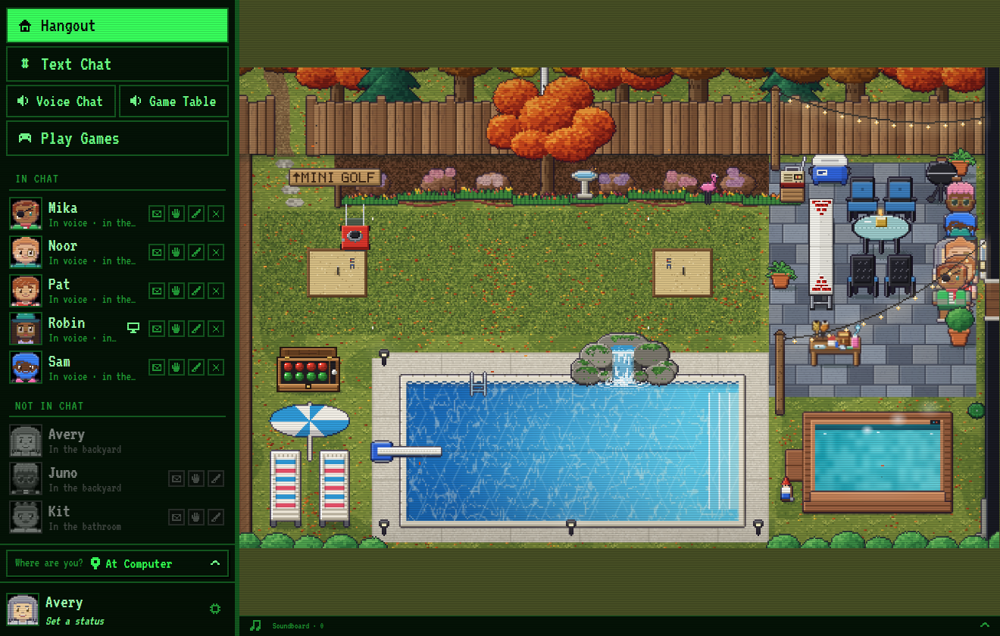

**The lake**, down the path past the campsite. Cast, wait for a bite, set the hook and reel it in. The board by the bait shop keeps the records.

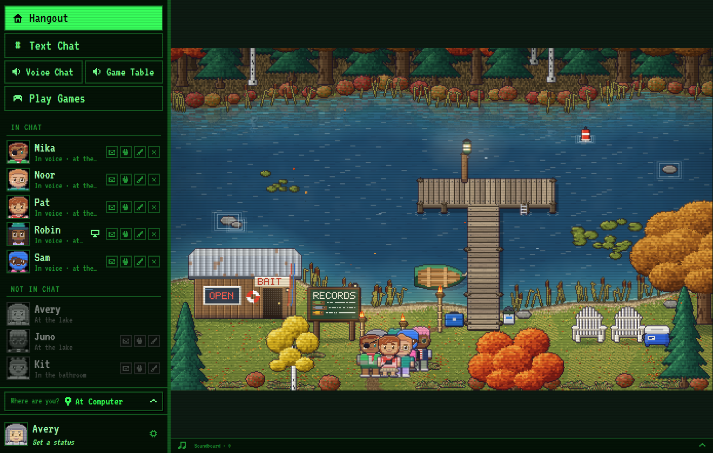

**Mini golf**, up the path from the backyard. Nine holes over three courses, with a score card.

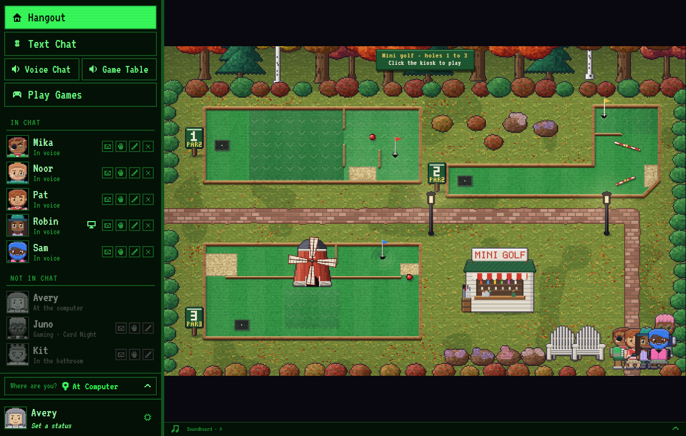

Outside follows the real time of day and the season, like the yard upstairs.

**The house**

- Characters, pets and desks that each person builds from parts (see below).
- Real weather and the real time of day in the yard, for the town you pick. The yard changes with the season.
- Click any seat, or any patch of floor, and your character goes there.
- Grab a drink from the fridge, take a shower, sweep the floor, work out, sink into a bean bag with your phone.
- Dance, hug, high five, or punch somebody. Pet a pet. Cats climb the cat tree.
- Birthdays (balloons, cake, party hat), pumpkins in October, a tree in December.
- A picture of your choosing in the gold frame on the lounge wall, and your group's photos in the smaller frames beside it. The photos change every day at the house's midnight, with no photo shown twice in a row.
- A clock on the wall in the house's own time zone, which the admin sets.
- A robot vacuum that does its rounds.

## Build your character

Nobody is handed a look. The first time you come in, you make one.

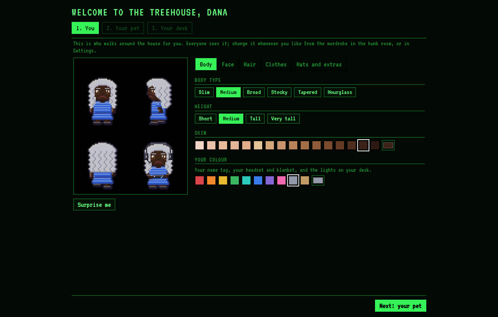

Body type, height, skin, eyes, brows, mouth, hair, facial hair, tops, bottoms, shoes, hats, glasses and accessories. Any colour for most of it.

It is drawn as you click, right there in the page. Nobody else sees it until you save.

Change it any time in Settings.

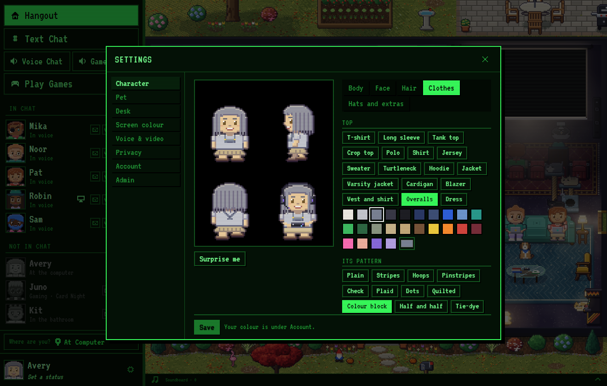

## Build a pet

A pet is optional. It is in the house whenever you are.

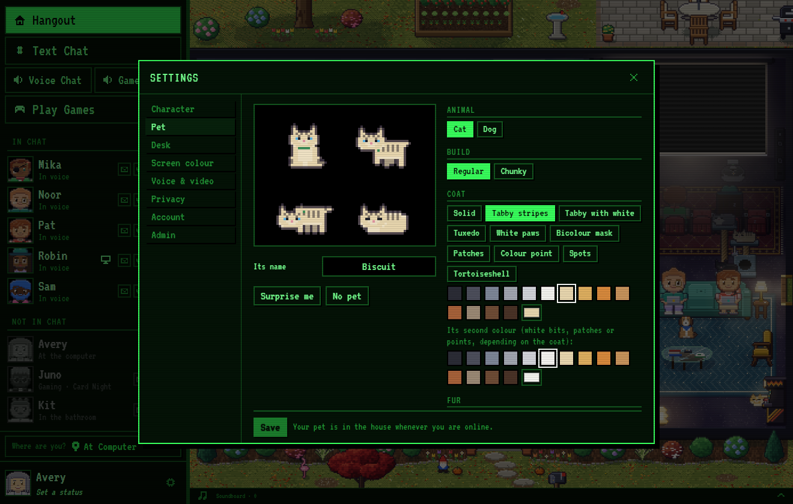

Cats and dogs, with a choice of build, coat, fur, ears, tail, eyes and collar.

It wanders, eats, naps, and comes to sit by people. Anyone can click it and stop to pet it.

## Set up your desk

Every desk is the same desk, and nobody owns one. Whichever you sit at is yours while you are there.

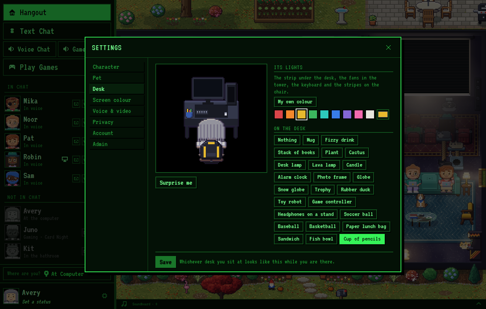

Pick the colour of its lights and one thing to keep on it.

## What you need

- A Windows 10 or 11 PC to host on. It has to be on for the hangout to be open.
- [Node.js](https://nodejs.org) 24 or newer on that PC.
- [Tailscale](https://tailscale.com) (free), so friends can reach it without opening your router.
- Friends on Windows for the desktop app. (A browser works on other systems, with limits. See Known limits.)

Python is only needed if you want to redraw the room's art.

## Host: set it up

> **Using an AI coding agent?** Point it at this repo and say "set this up for me". [AGENTS.md](AGENTS.md) walks it through hosting, building the installer and connecting friends, and tells it which steps are yours to do (signing in, accepting terms, sending invites).

```
npm install
npm run setup
npm run build
npm start
```

`npm run setup` downloads LiveKit (the voice and video engine) and checks it against LiveKit's published checksum.

Then open `http://127.0.0.1:4477` on that same PC (use your own port if you set `PORT` in `.env`).

The first person in sets the server up and becomes its admin. That only works from the PC the server runs on, so nobody else on your network can claim a new server. **Finish this step before turning on `tailscale serve` or any other proxy**: until it's done, the server refuses setup through a proxy, so set it up at `127.0.0.1` directly.

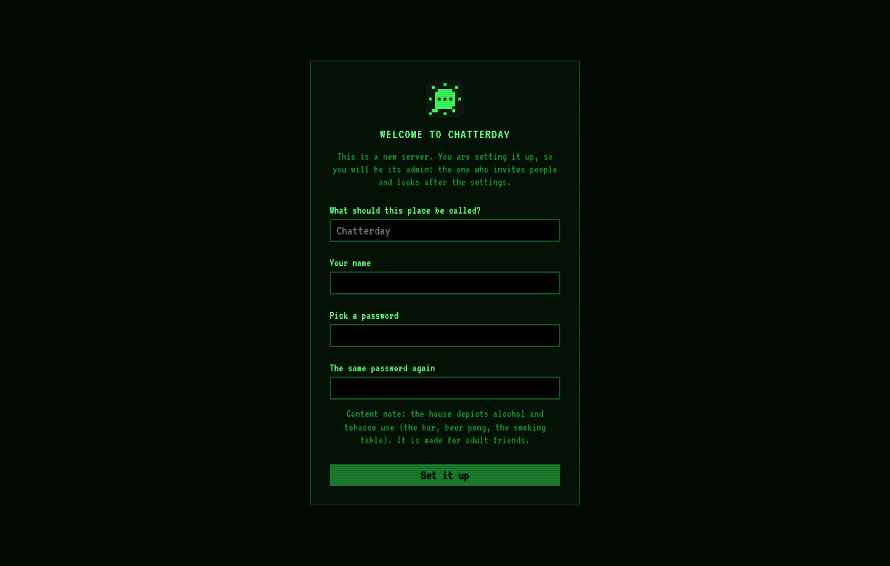

Name the place, pick your name and a password, and make your character.

After the first run, start it either way:

- **Chatterday Server.vbs**: no window, just an icon by the clock. Right-click it for the log, restart, or stop.
- **Start Chatterday.bat**: the same server in a window you can watch.

Both start the server again if it stops by itself.

To have it start with Windows, run `scripts\autostart.ps1` once. (`-Remove` undoes it.)

## Admin: make it yours

Everything is in **Settings → Admin**. Nothing needs a config file.

**New to hosting?** [docs/ADMIN-GUIDE.md](docs/ADMIN-GUIDE.md) walks you through it in order: what you have to do, what's optional (GIFs, weather, YouTube), and a few things it won't explain.

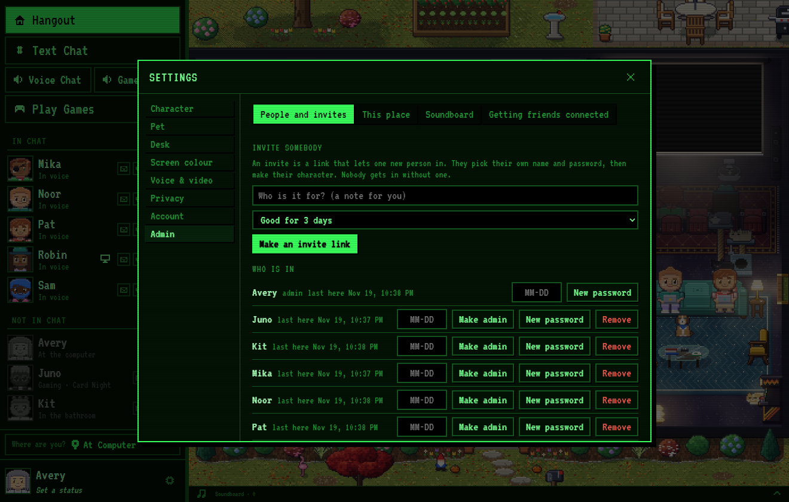

**People and invites.** Nobody gets in without an invite. Make a link, send it privately, and it works once. The newcomer picks their own name and password. You can cancel an unused invite, give somebody a new password, make somebody else an admin, or remove a person.

**This place.** The name, the picture on the wall, the photos in the wall's frames, the weather town, the house's time zone (it starts as the host PC's), and the keys.

**Soundboard.** Add a pile of sounds at once, or delete the ones nobody wants.

**Somebody's own entrance clip.** Make a folder called `entrance sounds` next to the app and put an audio file in it named after a person (`Sam.mp3` for Sam). It becomes that person's entrance sound, plays for everyone in the voice chat when they join (at most once an hour each), and stays off the soundboard. No restart needed.

**Getting friends connected.** The Tailscale steps with your own addresses filled in, and a button that builds the installer.

### Keys

| For | Needs a key? | Where to get it |
|---|---|---|
| Weather and the house clock | No | Type a town. It uses Open-Meteo, which is free and needs no key. |
| GIF search | Yes, free | [developers.giphy.com](https://developers.giphy.com): create an app, choose API, paste the key. |
| The Player's search | Optional, free | Without one, people paste YouTube links. To search by name, add a YouTube Data API key from the Google Cloud console (about 100 searches a day, free). |
| Friends connecting | No key | Each friend uses their own free Tailscale account. You share your PC with them from the Tailscale console. |

Keys are kept in the database on the host PC. Only the Giphy key is ever sent to your friends' apps, because each app searches Giphy itself.

You can keep keys in a `.env` file instead. See `.env.example`.

## Getting friends in

Friends reach your PC over Tailscale. Nothing is opened on your router, and the server ignores anything that is not your own PC or Tailscale.

The short version:

1. Install Tailscale on the host PC and sign in.
2. Run `scripts\firewall.ps1` once from an administrator PowerShell.
3. Add the access rules shown in **Settings → Admin → Getting friends connected** to your Tailscale console, so friends can reach only Chatterday.
4. Save your address there, then press **Build the installer**.
5. For each friend, **share your PC** from the Tailscale console (Machines → ⋯ → Share), and send them the share link, the installer and an invite.

**Chatterday does not include or install Tailscale.** Your friend installs Tailscale themselves from Tailscale's site, with their own free account (and agrees to Tailscale's terms there), accepts your share link, then uses the invite. The app walks them through it with a short checklist.

The full walkthrough is in [docs/CONNECTING-FRIENDS.md](docs/CONNECTING-FRIENDS.md).

The installer is not code-signed. Windows will warn about an unknown publisher: **More info → Run anyway**.

## How the house works

The house is the home screen, seen from above.

- **Offline or away**: not in the house at all. They walk out of the door.
- **At the computer**: at a desk. The monitor and the lights change if they are gaming or watching something.
- **In voice**: on the sofa and the armchairs.
- **Somebody is sharing a screen**: everyone in that voice chat moves to the theatre seats. The projector rolls down and shows the share. Click it to watch. If the sharer is in a game, the projector shows a screen for that kind of game (racing, shooter, cards and so on, all drawn for Chatterday) instead of a still of their desktop.
- **In the side room**: round the kitchen table.

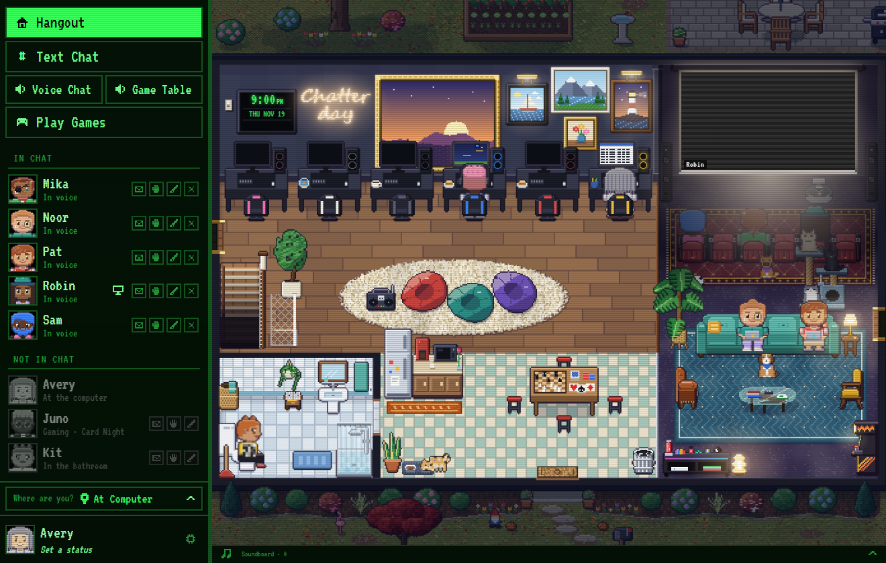

You can also say where you are yourself. Use the button above your name (Gaming, Watching, Working, Making food, Cleaning, Exercising, Showering, In the bathroom, Sleeping, Away), or click in the room: a desk, the sofa, a theatre seat, a bean bag, the game table, the arcade machine, the fridge, the shower, the door mat, or any free patch of floor. Where you clicked wins over what your PC reports until you click somewhere else.

Short errands end by themselves (the bathroom after 10 minutes, making food and a shower after 20, cleaning after an hour, a workout after an hour and a half), so nobody is left in the shower overnight.

The desktop app works out "gaming" and "watching" on its own. It sends one word, plus the game's name if you allow it. Window titles never leave your PC.

**Six seats.** Places are handed out as people come online: the first six get a desk, and keep it until they go. When they say they are sleeping, the desk turns into a bed with them in it. Anyone after the sixth is a visitor with a laptop, and naps on the sofa.

## Keeping it safe

- The server listens on `127.0.0.1` and the Tailscale address only. `CHATTERDAY_BIND=lan` adds the home network. `CHATTERDAY_BIND=all` is for a port-forward setup and should be avoided.
- Signing in needs a name and a password. Passwords are stored only as salted scrypt hashes, and wrong guesses are limited.
- A session is a random token in an HttpOnly, SameSite=Strict cookie. Only its hash is stored.
- Invites are single use and expire. Only their hash is stored.
- Voice and video are encrypted by WebRTC inside Tailscale's WireGuard tunnel.
- Uploads are identified by their real contents, not their name. Anything that is not a picture, sound or video is download-only.
- The page runs under a strict Content-Security-Policy. The desktop app's page is sandboxed with no access to Node.
- One person cannot hold the server up: messages, uploads, connections and sign-in tries are all limited, and `scripts/flood/` holds the tests the limits were found with.
- The desktop app asks before it installs an update, in a box the page cannot draw or click. Updates can also be signed with a key only you hold. See [docs/SIGNED-UPDATES.md](docs/SIGNED-UPDATES.md).
- Private chats are sent only to the two people in them. They are still stored in the database on the host PC, like everything else.

Everything personal lives in the `data` folder: the database, uploads and secret keys. It is not in git. **Back it up.**

Locked out as the admin? On the host PC: `node server/accounts.ts reset <name>`.

## Known limits

- **Windows only for hosting**, and for the desktop app. Game detection and window sound are Windows features.
- **A browser tab works, with limits.** Browsers need HTTPS for the microphone, so over plain Tailscale addresses the mic only works in the desktop app (or behind `tailscale serve`).
- **Push to talk** only works while the Chatterday window has focus. Use a mute hotkey elsewhere.
- **GIF search** is limited by Giphy's free tier (100 searches an hour for the whole group).
- **Music** plays in YouTube's own player, on screen: YouTube's rules don't allow sound without the picture, so folding the Player away stops it for you. Searching by name needs a YouTube API key (pasting links doesn't). A video its owner doesn't allow on other sites is skipped.
- **A whole screen is shared without sound.** Share a window to send sound.
- **Karaoke's song search needs the YouTube key.**
- **One pet each.**
- The host PC has to be on.

## Updating

UI changes: `npm run build`. Every open app notices within about fifteen seconds and reloads itself. (If its owner is in voice, it waits until they leave.)

Server changes also need the server restarted. Open `http://127.0.0.1:4477/local/status` on the host PC first and check `inVoice` is 0, because a restart drops everyone's voice.

Only changes under `desktop/` need a new installer. Raise `version` in `desktop/package.json`, build it again, and everyone with an older app sees an **Install** button. Pressing it makes the app ask "Install Chatterday x.y.z from (your address)?" before anything is fetched.

## Try it without touching real data

**Try Chatterday (demo).bat** builds the UI and starts a throwaway copy on port 4478 with fresh data.

It opens in your browser, signed in as the admin, and fills the house with pretend friends who change what they are doing every 24 seconds.

Close the window to stop it. It never touches `data/`.

```
npm test                              # draws hundreds of random characters, pets and desks and checks every part
node --test server/test/*.test.mjs    # the server's tests, each on a throwaway server of its own
node scripts/test-server.mjs          # a throwaway server on port 4478
node scripts/desktop-smoke.mjs        # drives the desktop app end to end against it
node scripts/screenshots.mjs          # retakes the pictures in this README from the demo
node scripts/flood/run.mjs            # floods a throwaway server of its own (port 4591) and checks it stays up
```

## What is where

| Folder | What is in it |
|---|---|
| `server/` | The Node server: web UI, chat, uploads, invites. It also runs LiveKit. The rules of each table game are in `server/games/`. |
| `client/` | The UI (React). Built into `client/dist`, which the server hands out. |
| `server/basement/`, `client/src/basement/` | The floors below and outside the house, and their games. A new floor needs no change anywhere else: the room and the server find it by its file name. |
| `client/src/draw/` | The artist. Characters, pets and desks are drawn here, in the browser, dot by dot. |
| `shared/` | The lists of parts (hair, hats, coats, desk items). The page and the server both read them. |
| `desktop/` | The Windows app friends install. A thin shell: tray, presence, hotkeys, screen picker. |
| `scripts/` | Setup, the demo, the tests, and the script that draws the room. |
| `data/` | Everything personal. Not in git. |

## Changing the art

No outside art is used. Every dot is drawn by code.

**A new hat, hairstyle, coat or desk item**: add it to the list in `shared/` and draw it in `client/src/draw/`. The builder shows it by itself, and the server accepts it.

`node scripts/preview-looks.mjs` and `node scripts/preview-pets-desks.mjs` write preview sheets to `art/` so you can check your work.

**The room**: `scripts/make-clubhouse.py` draws the floor, walls, furniture and the yard in each season (it needs Python with Pillow and numpy). Edit it, run it, then `npm run build`. The neon sign on the wall is written by the same script (`SIGN_LINES`).

**The other floors**: each one is drawn by its own `scripts/basement/<id>.py`, through `scripts/make-basement.py`.

**Cards, pieces and tiles**: `scripts/make-games.py`. The game screens for the projector: `scripts/make-game-screens.py`.

## If something is wrong

| Symptom | Likely cause |
|---|---|
| A friend's app says it cannot reach the server | Tailscale is not connected on their PC or yours, or `firewall.ps1` was not run |
| Text works but voice never connects | UDP 7882 is blocked (run `firewall.ps1`), or Tailscale started after Chatterday. Restart Chatterday |
| Video is blurry or stutters | Tailscale is relaying instead of connecting directly (`tailscale status` shows "relay"). Forward UDP 41641 on the host's router |
| "Voice is not running on the server" | `bin\livekit-server.exe` is missing. Run `npm run setup` |
| The microphone does nothing in a browser tab | Browsers need HTTPS for the mic. Use the desktop app |
| "Set the server up from the PC it runs on" | Open `http://127.0.0.1:4477` (or your `PORT`) on the host PC itself for the first run, typed exactly like that: not through `tailscale serve`, another proxy, or a different host name |

## Disclaimer and credits

**As-is, and not maintained.** Chatterday is shared as it is, for anyone who wants to run their own. I'm not maintaining this repository, so don't expect answers to issues or pull requests. Fork it, change it, make it yours.

**No warranty, no liability.** You run this on your own PC, for your own people, at your own risk. You're responsible for your server, your data, your network, who you invite, and what gets shared on it. The full terms are in [DISCLAIMER.md](DISCLAIMER.md).

**Tailscale and YouTube.** Chatterday doesn't include or install Tailscale: each person installs it from Tailscale's site and agrees to its terms themselves. Music plays only in YouTube's own visible player, and search uses only YouTube's official API with the host's own key. Chatterday isn't affiliated with Tailscale, YouTube or Google.

**What it's built on.** Chatterday stands on a lot of other people's work: open-source libraries, a font, a voice engine, a private network, and some free web services. Every one of them is listed, with its licence, in [THIRD-PARTY-NOTICES.md](THIRD-PARTY-NOTICES.md). Their own terms apply to them.

## Licence

MIT. See [LICENSE](LICENSE).
